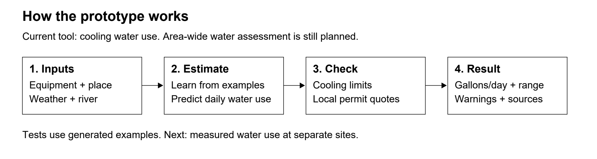

# ECOllateral: water use and new development

CSCI 4150 A2 | Shaun, Troy, Scott | Results recorded October 7, 2026

## What the project does

We want to help town planners, researchers, and water providers understand how new
buildings could affect local water supplies and rivers. The current program estimates
one part of that problem: water used to cool equipment.

Enter the equipment size, cooling method, location, and month. The program combines
these with saved weather and river readings. It returns estimated water use per day,
a low-to-high range, and quotes from local water permits.

The example 40-megawatt cooling-tower request returns about **204,000 gallons per day**.
A megawatt measures power. This example uses generated data; measured water use is
still needed to test the program at actual sites.

## How it works

The model learns patterns from examples. It uses equipment size, air temperature,
a temperature that accounts for humidity, river flow, drought, and time of year.
A separate calculation limits the estimate using the energy that needs cooling.
Permit search finds passages with similar words and keeps only local matches.
The program quotes those passages; a person decides how the permit applies.

## Three tests and what we learned

### E1: Which model makes smaller errors?

We compared RandomForest and XGBoost. Both learn rules from examples. Each cooling method had 1,600 generated examples. Older dates taught the models.
The two methods below each had 333 examples held aside for testing. Smaller average errors are better. Errors below are in US gallons per day.

| Cooling method | RandomForest | XGBoost |
| --- | --- | --- |
| Cooling tower | 4,890 | 3,668 |
| Direct evaporation | 3,842 | 3,191 |

XGBoost made smaller errors, so we kept it. These are errors against generated answers.
Dry cooling uses no evaporated water in this model, so both methods returned zero.

### E2: What if river readings are missing?

We removed 10%, 25%, and 40% of drought readings and repeated each test 50 times.
We filled gaps using a nearby station or the readings before and after the gap.
With similar generated stations, all prediction changes stayed within 50,000 gallons
per day of the complete-data result.

A separate test made the nearby readings too high. Only **60%** of changes from the
nearby-station method stayed within that limit, compared with **99%** from filling
between dates. This test used a simple formula, not the trained model. Both methods
also failed a stricter check on the range of changes for every drought date.
Nearby readings need checking. Filling between dates needs later readings, so it is
useful for past gaps rather than live estimates.

### E5: Did the prediction range work?

We wanted the low-to-high range to contain 90 out of every 100 test answers.
It contained about **88 out of 100** for both water-based cooling methods:
294 of 333 tower answers and 293 of 333 direct-evaporation answers.

That missed the goal. We used the same middle group of dates both to choose a model
and to set its range. Those jobs should use separate data. We have not tested whether
the small shortfall could be due to chance.

## Other checks: E3 and E4

Deliberately impossible estimates were moved inside the calculated limits and flagged.
The original estimate remains visible. Four location tests returned the expected
permit matches. These tests used fictional permits. Physical limits depend on the
cooling assumptions; local quotes do not establish legal compliance.

## Decisions and next step

- **Keep (Adopt):** the model comparison, physical checks, and local permit quotes.
- **Improve (Modify):** gap filling and prediction ranges, based on E2 and E5.
- **Reject:** using a model fit score as a promise of accuracy, or cooling use alone
  as a measure of the whole area's water health.
- **Wait (Defer):** more complicated AI until we have measured water-use examples.

Next, train and test with measured water use at separate sites. An area assessment
also needs other water uses, water returned, available supply, and river needs.
The main question remains: **how would a new development affect local water?**

## Evidence and methods

E1: `../evidence/regression-comparison.csv`. E2: `../evidence/missingness-summary.csv`
and `../evidence/biased-donor-diagnostic.csv`. E3/E4: `../evidence/constraint-failure-cases.json`
and `../evidence/retrieval-cases.json`. E5: `../evidence/interval-coverage.csv`.
Exact methods and assumptions: `../../implementation-notes.md`. Data sources, units,
and the unchecked climate-division match: `../../data-contracts.md`.
Results use the October 7 implementation; permit search now compares word scores
directly without a separate search library. Team roles and course status: `../README.md`.
